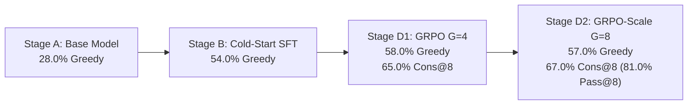

# Self-Correcting Micro-Reasoner
### Training a Small Language Model to Improve Reasoning via GRPO and Verifiable Rewards (RLVR)

[](https://huggingface.co/Adityapande403/Self-Correcting-Micro-Reasoner)
[](https://github.com/adityapande403/Self-Correcting-Micro-Reasoner)
[](https://opensource.org/licenses/Apache-2.0)
[](https://www.python.org/)
[](https://pytorch.org/)
[](https://www.nvidia.com/)

---

## 1. Research Overview

This repository investigates whether reinforcement learning with deterministic, verifiable rewards (**RLVR**) via **Group Relative Policy Optimization (GRPO)** and test-time compute scaling can improve the problem-solving fidelity of a small language model (~1.5B parameters) without requiring a learned critic.

### Central Research Question
> *Can a 1B–1.5B-parameter language model learn more reliable problem-solving and useful self-correction behaviors through a short supervised warm-up followed by GRPO training against automatically verifiable answers?*

### Three Distinct Outcomes Evaluated:
1. **Answer Improvement:** Does exact-answer correctness increase?
2. **Process Improvement:** Does the model identify intermediate mistakes and successfully revise them?
3. **Output-Length Change:** Does the model generate longer or more structured responses without artificial token padding?

---

## 2. Experimental Progression & Results ($N=100$ Test Problems)

The project implements a controlled post-training progression evaluated on identical, strictly held-out test sets from GSM8K:



| Stage | Model Variant | Objective | Exact Accuracy | Parse Rate | Mean Tokens |
|---|---|---|---|---|---|
| **Stage A** | Unmodified Base (`Qwen2.5-1.5B-Instruct`) | Establish zero-shot baseline | **28.00%** | 38.00% | 389.4 |
| **Stage B** | Cold-Start SFT (250 steps) | Format contract (`<think>...</think><answer>...</answer>`) | **54.00%** | **100.00%** | 131.2 |
| **Stage D1** | SFT + GRPO ($G=4$, 100 steps) | RLVR policy gradient with deterministic rewards | **58.00%** | **100.00%** | 138.7 |
| **Stage D2** | Scaled GRPO ($G=8$, 150 steps) | Double exploration group to minimize zero-variance | **57.00%** | **100.00%** | 138.0 |
| **Stage D1 Cons@8** | Consensus Voting ($K=8$, $T=0.7$) | Test-time compute majority voting | **65.00%** | **100.00%** | 1075.5 |
| **Stage D2 Cons@8** | Scaled Consensus Voting ($K=8$, $T=0.7$) | Mode aggregation across scaled exploration policy | **67.00%** | **100.00%** | 1082.0 |
| **Stage D2 Pass@8** | Oracle Upper Bound ($K=8$) | At least 1 of 8 trajectories correct | **81.00%** | **100.00%** | 1082.0 |

---

## 3. Quickstart & Hugging Face Model Usage

You can load the trained checkpoint directly using Hugging Face `transformers` and `peft`:

```python
import torch
from transformers import AutoModelForCausalLM, AutoTokenizer
from peft import PeftModel

model_id = "Adityapande403/Self-Correcting-Micro-Reasoner"
base_model_id = "Qwen/Qwen2.5-1.5B-Instruct"

tokenizer = AutoTokenizer.from_pretrained(model_id)
base_model = AutoModelForCausalLM.from_pretrained(
    base_model_id,
    torch_dtype=torch.bfloat16,
    device_map="auto"
)
model = PeftModel.from_pretrained(base_model, model_id)
model.eval()

prompt = "A baker makes 12 cakes per hour. If they work for 4 hours and sell each cake for $15, how much money do they earn?"
messages = [
    {
        "role": "system",
        "content": (
            "You are a careful mathematical reasoning assistant. "
            "First, think through the problem step by step inside <think>...</think> tags. "
            "Then, write your final answer inside <answer>...</answer> tags."
        )
    },
    {"role": "user", "content": prompt}
]

inputs = tokenizer.apply_chat_template(messages, return_tensors="pt", add_generation_prompt=True).to(model.device)
with torch.no_grad():
    outputs = model.generate(inputs, max_new_tokens=512, temperature=0.0)

print(tokenizer.decode(outputs[0][inputs.shape[1]:], skip_special_tokens=True))
```

---

## 4. Hardware & Environment Setup

- **GPU:** NVIDIA GeForce RTX 5060 Ti (16 GB VRAM, Blackwell `sm_120`).
- **RAM:** 128 GB System RAM.
- **CPU:** Intel Core i7-14700K.
- **PyTorch Engine:** PyTorch 2.11.0+cu128 (CUDA 12.8 Toolkit for native Blackwell sm_120 support).
- **VRAM Footprint:** Peak memory stays under 4.2 GB VRAM across all training stages ($G=4$ and $G=8$).

### Installation
```bash
# Clone the repository
git clone https://github.com/adityapande403/Self-Correcting-Micro-Reasoner.git
cd Self-Correcting-Micro-Reasoner

# Install dependencies
pip install -r requirements.txt
```

---

## 5. End-to-End CLI Workflow

Follow this sequence to replicate the full experimental pipeline:

### Step 1: Run Verifier Unit Tests
Verify the deterministic math, fraction, LaTeX, symbolic, and SQL execution verifiers:
```bash
python -m pytest tests/
```

### Step 2: Prepare and Validate Dataset
Download official GSM8K splits, synthesize multi-step problems, and generate manifests:
```bash
python -m src.data.prepare_dataset
python -m src.data.split_dataset
python -m src.data.validate_dataset
```

### Step 3: Stage A Baseline Evaluation
Measure the unmodified model baseline:
```bash
python scripts/run_baseline.py --limit 100 --batch-size 4
```

### Step 4: Stage B Supervised Fine-Tuning
Train the model on the cold-start reasoning dataset:
```bash
python scripts/run_sft.py --config configs/sft.yaml
```

### Step 5: Stage D GRPO Reinforcement Learning
Train the policy using group rollouts and deterministic verifiers:
```bash
# Standard GRPO (100 steps, G=4)
python scripts/run_grpo.py --config configs/grpo.yaml

# Scaled GRPO (150 steps, G=8)
python scripts/run_grpo.py --config configs/grpo_scale.yaml
```

### Step 6: Benchmark & Self-Correction Evaluation
Run comprehensive evaluation including Two-Pass revision experiments:
```bash
python scripts/run_evaluation.py --stage grpo --limit 100 --batch-size 4 --correction
```

### Step 7: Self-Consistency Majority Voting
Run Consensus@8 evaluation to test test-time compute scaling:
```bash
python scripts/run_consensus.py --adapter outputs/checkpoints/grpo_scale/final --k 8 --limit 100
```

### Step 8: Generate Publication Visualizations
Render all 7 publication figures and summary markdown:
```bash
python scripts/generate_report.py
```

---

## 6. Summary of Empirical Findings

1. **Format Alignment Unlocks Latent Reasoning:** The base model's apparent failure (28%) was primarily caused by format instability (62% invalid output rate). Format SFT raised parse success to 100% and exact accuracy to 54%.
2. **GRPO Yields Genuine Reasoning Gains Without Bloat:** GRPO training with verifiable rewards increased greedy exact-answer accuracy from 54% to 58% while condensing P95 token length from 226 down to 201 tokens.
3. **Self-Correction Dynamics:** 
   - Under two-pass revision (Exp C), the model achieved a 26.09% correction rate (fixing incorrect initial answers).
   - An 18.52% regression rate was observed where correct answers were unnecessarily revised.
   - Net accuracy improved by +2.0%, at a $2.21\times$ inference token cost.
   - Unprompted natural self-correction words ("Wait," "Actually") occurred 0 times. Prompting the model to verify in a single pass collapsed accuracy to 6.0%.
4. **Test-Time Compute Bridges to 67%–81%:** Majority voting across 8 sampled rollouts pushed accuracy to **67.00%**, with at least one correct trajectory existing in **81.00% of all problems (Pass@8)**.

---

## 7. Repository Structure
```
Self-Correcting-Micro-Reasoner/
├── configs/                  # Model, SFT, GRPO, and GRPO-Scale YAMLs
├── data/
│   ├── raw/                  # Downloaded raw GSM8K datasets
│   ├── processed/            # Unified problem pools
│   ├── splits/               # Held-out train, val, and test splits
│   └── manifests/            # Cryptographic SHA256 dataset manifests
├── src/
│   ├── data/                 # Preparation, validation, and splitting
│   ├── models/               # Model loading, PEFT/LoRA, inference engine
│   ├── sft/                  # SFT training pipeline
│   ├── rl/                   # GRPO training, rollout manager, reward logger
│   ├── verifiers/            # Deterministic numeric, fraction, symbolic, SQL verifiers
│   ├── evaluation/           # Metric aggregators, consensus, and self-correction suite
│   ├── experiments/          # Local experiment tracker
│   └── utils/                # Config, logging, memory, reproducibility
├── tests/                    # 34 automated pytest test suites
├── scripts/                  # CLI execution scripts
├── outputs/
│   ├── checkpoints/          # SFT, GRPO, and GRPO-Scale LoRA weights
│   ├── plots/                # 7 generated publication figures
│   └── reports/              # Detailed evaluation JSON records
├── requirements.txt
├── README.md
├── MODEL_CARD.md
├── EXPERIMENT_REPORT.md
└── LICENSE
```

---

## 8. License
Distributed under the Apache 2.0 License. See `LICENSE` for details.
